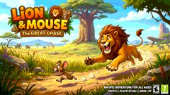
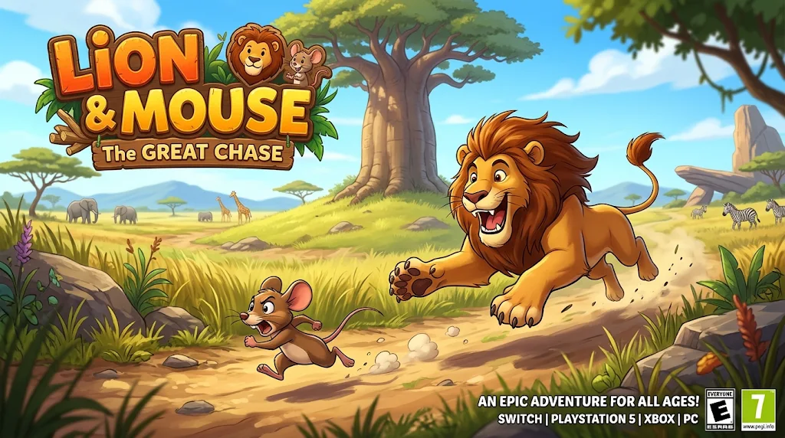

# Lion Chase — The Great Chase

A colorful, mobile-friendly 3D endless runner starring a lion chasing a very quick mouse. Dodge hazards, collect coins, throw rocks to catch the mouse, and build up a trail of saved records and trophies.

<p align="center">
  
</p>

<p align="center"><em>Animated cover preview — a gentle zoom loop made from the original cover artwork.</em></p>

## Cover art

<p align="center">
  
</p>

The supplied cover art fills the game's opening screen. Tap the start button, tap the cover, or wait for the menu to open.

## Features

- **3D runner gameplay:** weave through three lanes, jump over red hurdles, slide under low beams, and avoid full lane walls.
- **Mouse chase:** land four rock hits to catch the mouse; a successful catch awards bonus points and advances the stage.
- **Eight stages:** unlock new stages as you progress, or choose Endless Run for a continuous challenge.
- **Pickups and boosts:** collect coins and crystals; crystals replenish your rocks, and magnets draw in nearby coins.
- **Four visual themes:** Jungle Trail, Sunset Canyon, Moonlit Run, and Glacier Pass. Theme changes update the game world and menus.
- **Settings that stick:** choose display scale, sound, voice guide, English or Urdu callouts, an installed narrator voice, and reduced motion.
- **Records and trophies:** track your personal best, lifetime coins, longest distance, mice caught, and five milestones.
- **Mobile controls:** touch buttons and swipe gestures, with responsive layouts for portrait and landscape screens.
- **Local progress saving:** scores, coins, unlocked stages, trophies, and preferences save in this browser on this device.
- **No build step:** the game is a single HTML file and loads Three.js from a CDN.

## Play the game

### Quick start

1. Download or clone this repository.
2. Keep `Lion Chase.html` and `image.png` together in the same folder.
3. Open `Lion Chase.html` in a current desktop or mobile browser with internet access.

If your browser blocks local scripts or assets, serve the folder over HTTP instead:

```sh
python -m http.server 8000
```

Then visit [http://localhost:8000/Lion%20Chase.html](http://localhost:8000/Lion%20Chase.html). The first load needs an internet connection to fetch Three.js and its model loader from the CDN.

## How to play

- Start a stage from the **Play** page, or choose **Endless Run**.
- Move between lanes to avoid obstacles and keep running.
- Pick up coins for points and crystals to refill your rock supply.
- Throw rocks at the mouse. Four successful hits catch it and clear the stage.
- Red hurdles require a jump. Low yellow beams require a slide. Grey walls block a lane, so move away early.
- A magnet boost pulls nearby coins toward you. Watch the HUD for your score, coins, rocks, mouse hits, speed, distance, and lives.

### Controls

| Action | Keyboard | Touch |
| --- | --- | --- |
| Change lane | `A` / `D` or `←` / `→` | Left and right buttons; swipe left or right |
| Jump | `W` or `↑` | Up button; swipe up |
| Slide | `S` or `↓` | Down button; swipe down |
| Throw a rock | `Space` | Rock button |
| Pause / resume | `P` or `Esc` | Pause button |
| Return to menu | `Esc` or menu button | Menu button |

On phones and tablets, the on-screen controls are enabled automatically. For the best play area, use landscape orientation; portrait mode is supported too.

## Screens and settings

The game has five menu pages:

- **Play:** pick an unlocked stage or launch Endless Run.
- **Records:** review your saved best score, lifetime coins, longest distance, and mice caught.
- **Trophies:** see progress for First Steps, Pocket Change, Long Way Home, Mouse Catcher, and Stage Explorer.
- **Settings:** change sound, world theme, display size, voice guide, voice language, narrator, reduced motion, or reset records.
- **How to play:** review controls and hazard tips.

Theme and display changes apply immediately, including when changed in Settings. Available narrator voices depend on the voices installed in the browser or operating system. Speech is provided by the browser's speech synthesis, and can be turned off at any time.

## Saved data

The game stores progress in the browser's `localStorage`. It is local to the browser profile and device; it is not synced to a server. Clearing site data or switching browsers/devices clears or separates that progress. Use **Settings → Reset records** to clear saved records from inside the game.

## Project files

| File | Purpose |
| --- | --- |
| `Lion Chase.html` | Complete game, UI, styles, gameplay, settings, and save logic |
| `image.png` | Cover art used on the full-screen opening screen |
| `assets/chase-preview.gif` | Animated README preview created from the cover artwork |
| `README.md` | Project overview and player guide |

## Troubleshooting

- **A blank screen or missing 3D scene:** confirm internet access so the Three.js CDN scripts can load, then refresh.
- **Cover art does not appear:** make sure `image.png` is beside `Lion Chase.html` and keep the filename unchanged.
- **Voice is silent or the preferred voice is missing:** check device volume, enable the Voice Guide setting, and choose an available installed voice. Some browsers require a user tap before speaking.
- **Records appear empty:** open the same browser profile and origin used to play; local files and localhost can have separate saved data.

## Technology

- HTML, CSS, and vanilla JavaScript
- Three.js (loaded from jsDelivr CDN)
- Browser speech synthesis for optional voice callouts
- Browser `localStorage` for local settings and progress

## License and attribution

The repository includes the supplied `image.png` cover artwork. No separate license file is currently included; add one if you intend to distribute or reuse the project publicly.
